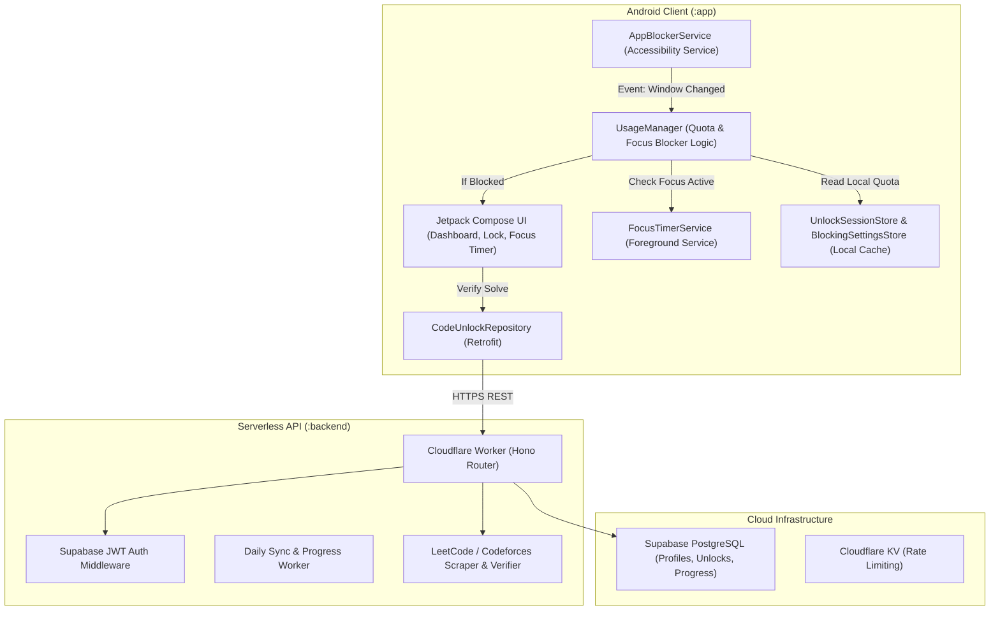

# ARCHITECTURE.md — System Architecture

## Architecture Overview

## Module Boundaries

1. **`:android-contracts`**:
   - DTOs, API Interfaces (`CodeUnlockApiService`), OkHttp client, Retrofit network module, repository abstractions.
2. **`:app`**:
   - **`service`**: `AppBlockerService` (accessibility window listener), `FocusTimerService` (Pomodoro timer + audio synthesis), `ReelsShortsInterceptor`, `SettingsGuardInterceptor`.
   - **`data`**: `UsageManager`, `UnlockSessionStore`, `BlockingSettingsStore`, `FocusSessionStore`.
   - **`ui`**: Material 3 screens: `DashboardScreen`, `LockActivity`, `FocusTimerScreen`, `PermissionSetupScreen`, `ProblemScreen`.
3. **`backend`**:
   - Cloudflare Workers REST API with routes for problems, verification, unlocks, wellbeing sync, rankings, and social classrooms.
4. **`GSD & Integrations`**:
   - Workflows in `.agent/workflows/`
   - Agent skills in `.agents/skills/`
   - MCP configurations for Supabase & Playwright in `mcp_config.json`.
   - CodeRabbit code review plugin in `.agents/plugins/coderabbit`.
